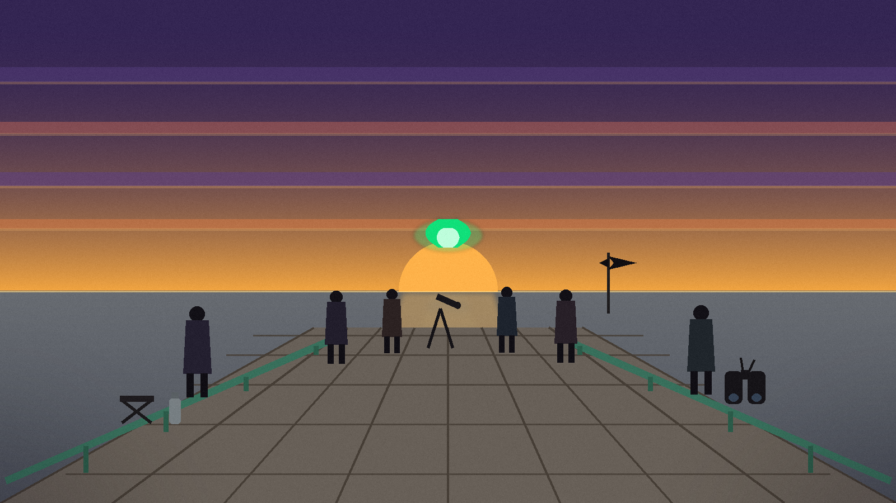

# UFO-Detector




A novelty radar page that pretends to scan for UFOs. A green radar sweep
animates in a circle, and at random the page flashes `UFO DETECTED!` with
a red blip and a sound effect, then goes back to scanning. It detects
nothing real; the detections are dice rolls.


## Run

Open `index.html` in a browser, or serve the folder:

```bash
python3 -m http.server
# then visit http://localhost:8000/
```

The page loads GSAP and Howler from public CDNs and the two sound effects
from Mixkit, so the animations and sounds need network access. If a CDN
is unreachable the page still loads and still scans and detects, only
silently and without the blip animation flourish: the blip is shown and
hidden directly instead.


## How it behaves

- A scan check runs every 3.5 seconds, with the detection roll delayed
  0.5 seconds after each check.
- Each roll has a 30 percent chance of a detection.
- On a detection the message changes to `UFO DETECTED!`, the detection
  sound plays (when Howler loaded), and the blip pulses. After 3 seconds
  the message returns to `Scanning for UFOs...` and scanning resumes.
- An ambient loop starts on page load when Howler loaded. Browsers may
  hold audio until the first interaction with the page.
- The blip is centered on the radar with negative margins, half its
  10px size. It used to be centered with a CSS translate, and GSAP
  writes its own transform when it scales the blip for the pulse, so
  the centering could be replaced for the length of a detection and
  the dot could sit off center while it pulsed. Margins are not a
  transform, so the pulse cannot replace them now. That fault was
  logged as suspected and never observed in a browser; the fix
  removes the conflict in the stylesheet itself rather than waiting
  to catch it on screen.


## Tests

```bash
node --test
```

10 tests, all passing, in `detector.test.mjs`. They load the real
`script.js` in Node with stubbed document, window, and timer
objects: the 3.5 second check and 0.5 second roll delay, a missed
roll, a detection with GSAP (pulse values and the 3 second reset),
a detection without GSAP (the blip shown and hidden directly),
ticks dropped during a detection, both sounds built and the
ambient loop started when Howler is present, detection still
working when Howler is missing or a sound throws on play, the
margin centering above, and the ids and CDN scripts in
`index.html` that the script depends on.


## Files

- `index.html` - the page
- `script.js` - scan loop, detection roll, sounds, and blip animation
- `style.css` - layout and the radar sweep animation
- `detector.test.mjs` - the node:test suite
- `LICENSE` - MIT license
- `logo.png`, `banner.png` - project branding


## Honest limits

The logic is verified headlessly by the suite above, including the
cases where one or both CDN libraries are missing. The page was not
run in a real browser for this pass, so the visual result (the
centered blip included) and the actual audio playback were not
observed on screen.

> **Log margin note:** this page detects nothing real, its sounds and animation libraries need network access, and it was not observed in a real browser for this pass.
